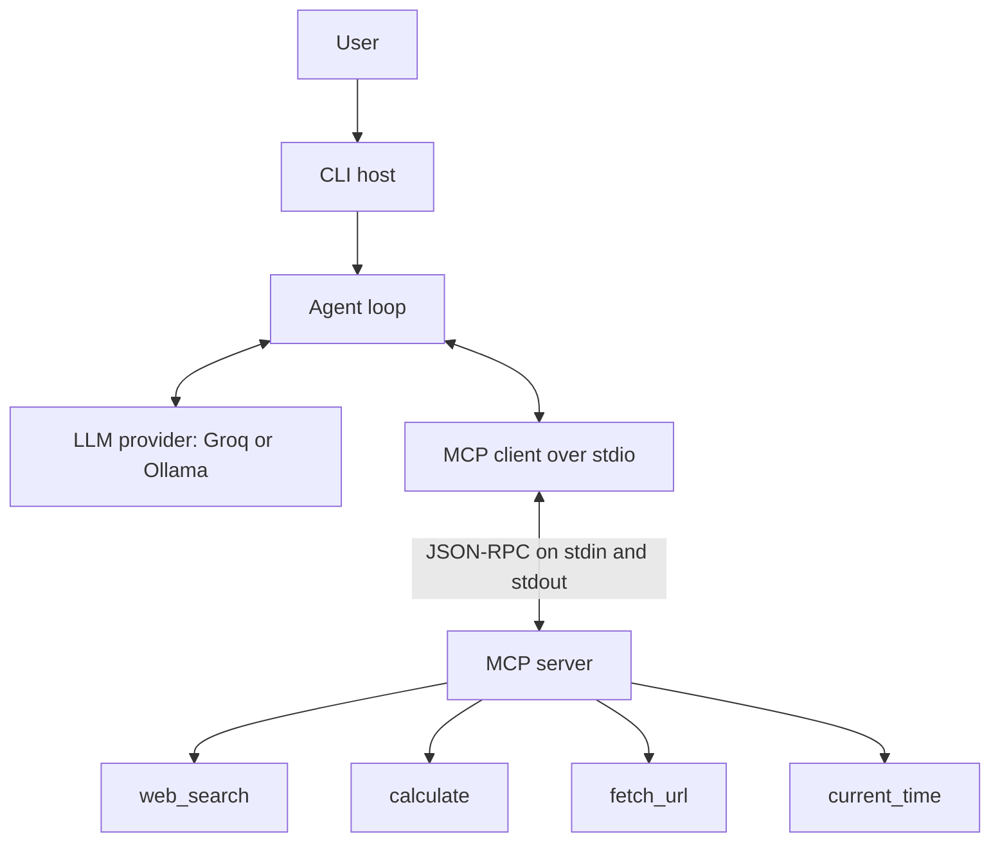
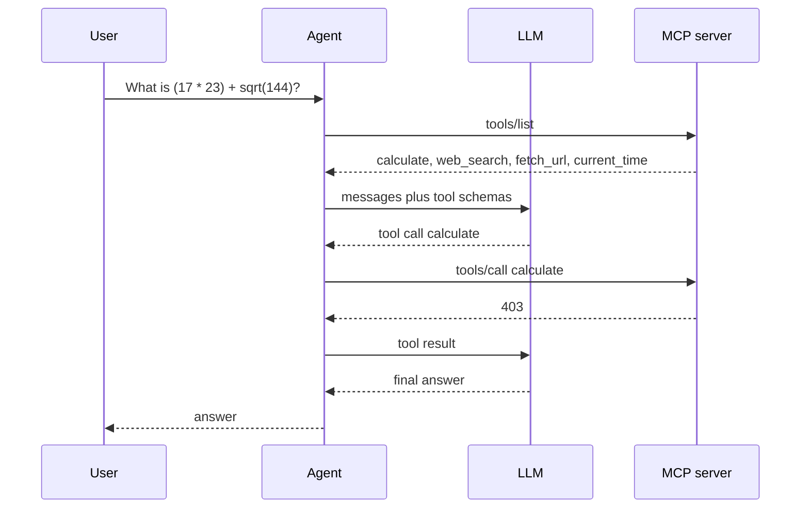

# ai-agent-mcp

A small, free AI agent that answers questions by calling tools over the [Model Context Protocol](https://modelcontextprotocol.io). The language model runs on [Groq's free API](https://console.groq.com) or on [Ollama](https://ollama.com) on your own machine. Web search goes through DuckDuckGo and does not need an API key. The default path does not call a paid service and does not ask for a credit card.

The project is a complete MCP host and server, not a wrapper around a single chat endpoint. Tools live in their own process. The agent discovers them at runtime with `tools/list`, then calls them with `tools/call` over stdio. The same server can be attached to any other MCP host.

[](https://github.com/taha080/ai-agent-mcp/actions/workflows/ci.yml)

## Features

- MCP server, built with the official [`mcp`](https://github.com/modelcontextprotocol/python-sdk) Python SDK (v2), speaking stdio.
- Four tools: keyless web search, a safe calculator, an HTTP fetch with timeouts and size limits, and the current time.
- Tool-calling loop that lists those tools, sends their JSON Schemas to the model, executes the requested calls, and stops when the model answers.
- Two free model providers, selected with a flag or an environment variable: Groq and local Ollama. Both are used through the OpenAI-compatible chat API.
- CLI for a single question, an interactive chat, listing tools, or serving MCP on stdio.
- Offline test suite. Network calls and model calls are mocked. Lint and tests run in GitHub Actions.

## Quick start

Requires Python 3.11 or newer.

```bash
git clone https://github.com/taha080/ai-agent-mcp.git
cd ai-agent-mcp
python -m venv .venv
source .venv/bin/activate
pip install -e ".[dev]"
cp .env.example .env
```

Put a Groq key in `.env` (see below), then:

```bash
ai-agent-mcp tools
ai-agent-mcp ask "What is (17 * 23) + sqrt(144)?"
ai-agent-mcp --show-trace ask "Search for the Model Context Protocol and summarize it in three sentences."
ai-agent-mcp chat
```

`--show-trace` prints each tool call and its result on stderr. The answer stays on stdout, so you can pipe it.

Use Ollama instead of Groq:

```bash
ai-agent-mcp --provider ollama --model llama3.2 ask "What time is it in Tokyo?"
```

You can also run the package module directly: `python -m ai_agent_mcp ask "2 + 2"`.

## Architecture

The CLI is the host. It owns the conversation and the model. It does not implement search, math, or HTTP itself. Those are tools on an MCP server that the host launches as a child process.



One question that needs arithmetic looks like this:



The loop stops when the model returns a message with no tool calls, or when it hits `--max-steps` (default 8). Several tool calls in one model response are executed before the next model request. A tool error is sent back as the tool result so the model can correct the arguments. The model is not given a chance to pretend the tool succeeded.

### How MCP is used

The server is `MCPServer` from `mcp.server`. Each tool is a typed Python function with `@mcp.tool()`. The SDK builds the JSON Schema from the type hints and the docstring, serves `tools/list` and `tools/call`, and speaks the protocol. `python -m ai_agent_mcp.server` calls `mcp.run()`, which is the stdio transport: one JSON-RPC message per line on stdin and stdout. Logging goes to stderr so it cannot corrupt the stream.

The agent uses the SDK `Client` with `StdioServerParameters`. Entering the client context starts the server subprocess, negotiates the protocol, and closes the process on the way out. The session turns each MCP tool into an OpenAI function definition (`name`, `description`, `parameters`) because that is the tool-calling shape both Groq and Ollama accept. Results come back as MCP content blocks and are flattened to text for the next model turn.

The server publishes short instructions. The client reads `client.instructions` and appends them to the system prompt, so the model hears the server's own description of the tools rather than a second hard-coded copy.

Because the server is a normal stdio MCP server, another host can use it without this agent. A Claude Desktop or Cursor snippet looks like this (use the Python that has the package installed):

```json
{
  "mcpServers": {
    "ai-agent-mcp": {
      "command": "python",
      "args": ["-m", "ai_agent_mcp.server"]
    }
  }
}
```

## Tools

| Tool | What it does | What it refuses |
| --- | --- | --- |
| `calculate` | Arithmetic with `+ - * / // % **`, parentheses, and `abs`, `round`, `sqrt`, `min`, `max`, `pow`. | Anything outside that allowlist. The implementation walks an AST. It does not call `eval`, `exec`, or `compile`. Exponents and results are capped. |
| `web_search` | Text search through the [`ddgs`](https://pypi.org/project/ddgs/) metasearch library, which queries DuckDuckGo and needs no key. Returns titles, URLs, and snippets. `max_results` is clamped to 1..10. | Empty or very long queries. |
| `fetch_url` | GET one public `http` or `https` URL and return readable text. HTML is converted to text with the standard library. Scripts and styles are dropped. | Non-HTTP schemes, `localhost`, `*.local`, `*.internal`, literal private and link-local addresses (including the cloud metadata address), redirects onto those addresses, and hostnames that resolve there. Timeout 15s, up to 5 redirects, body capped at 500 KB. JavaScript is not executed. |
| `current_time` | Local clock in an IANA timezone, as an ISO-8601 string. No network. | Unknown timezone names. |

`fetch_url` checks the addresses a hostname resolves to before reading the body. That blocks the common case of a public name pointing at an internal IP. It is not a complete SSRF defense against DNS rebinding within a single request, and it is not a browser.

## Configuration

Flags override environment variables. A `.env` file in the working directory is loaded if present and does not override variables already set in the shell. `.env` is gitignored. `.env.example` is the template and contains no secrets.

| Variable | Flag | Default | Meaning |
| --- | --- | --- | --- |
| `AGENT_PROVIDER` | `--provider` | `groq` | `groq` or `ollama` |
| `GROQ_MODEL` | `--model` | `llama-3.1-8b-instant` | Groq model id. `llama-3.3-70b-versatile` is a stronger free-tier option when you want better tool calling. |
| `OLLAMA_MODEL` | `--model` | `llama3.2` | Local model name. It needs to support tool calling. |
| `GROQ_API_KEY` | | empty | Free key from Groq. Required only when the provider is Groq. |
| `GROQ_BASE_URL` | | `https://api.groq.com/openai/v1` | Override for tests or a proxy. |
| `OLLAMA_BASE_URL` | | `http://127.0.0.1:11434/v1` | Ollama's OpenAI-compatible base. A URL without `/v1` is accepted. |
| `AGENT_MAX_STEPS` | `--max-steps` | `8` | Model calls per user message. |
| `AGENT_TEMPERATURE` | | `0.2` | Sampling temperature, from 0 to 2. |
| `AGENT_LLM_TIMEOUT` | | `120` | Seconds to wait for one model response. |
| | `--show-trace` | off | Print tool calls and full results to stderr. The chat command always prints a short preview. |

`ai-agent-mcp tools` and `ai-agent-mcp serve` do not need an API key.

### Groq

1. Create a free account at [console.groq.com](https://console.groq.com). The free tier does not require a credit card.
2. Open [API keys](https://console.groq.com/keys) and create a key.
3. Copy `.env.example` to `.env` and set `GROQ_API_KEY`. Leave the file untracked.
4. Confirm the model id against the [current model list](https://console.groq.com/docs/models). Free-tier rate limits change; `llama-3.1-8b-instant` is the default because it supports tool calling and has a generous daily quota. If a model id is retired, set `GROQ_MODEL` or pass `--model`.

The client sends `Authorization: Bearer ...` and never writes the key into the request body, the logs, or the repository.

### Ollama

1. Install Ollama from [ollama.com](https://ollama.com) and start it (`ollama serve` if it is not already running as a service).
2. Pull a model that can call tools:

   ```bash
   ollama pull llama3.2
   ```

3. Run the agent with `--provider ollama`. No key is read.

Ollama's OpenAI-compatible endpoint is `http://127.0.0.1:11434/v1/chat/completions`. Tool-calling quality depends on the model. If a local model ignores the tools array, pick another tool-capable model such as a recent Llama 3.1, Llama 3.2, or Qwen 2.5 build.

## Usage

```bash
# List the tools the server actually exposes.
ai-agent-mcp tools

# One question. Arithmetic should go through calculate, not mental math.
ai-agent-mcp ask "What is (17 * 23) + sqrt(144)?"

# Show the tool trace while researching.
ai-agent-mcp --show-trace ask "What is the Model Context Protocol? Search, then answer in three sentences."

# Interactive session. /tools reprints the tool list. /exit quits.
ai-agent-mcp chat

# Run only the server. A host owns stdin and stdout. This blocks.
python -m ai_agent_mcp.server
```

In chat, each user line is one turn. The conversation, including tool results, is kept in memory until you exit. It is not written to disk.

Illustrative trace for the arithmetic question (`--show-trace`). The final sentence is the model's; the tool result is not.

```text
tool> calculate {"expression": "(17 * 23) + sqrt(144)"}
403
(17 * 23) + sqrt(144) is 403.
```

## Development

```bash
pip install -e ".[dev]"
python -m ruff check .
python -m ruff format --check .
python -m pytest
```

The suite is offline:

- Calculator tests check ordinary arithmetic and reject imports, `eval`, attribute access, huge exponents, and division by zero. A second test parses the calculator module and fails if it contains a call to `eval`, `exec`, or `compile`.
- Fetch tests use `httpx.MockTransport`. They cover HTML cleaning, plain text, JSON, truncation, HTTP errors, timeouts, non-text bodies, blocked URLs, redirects onto loopback, and a hostname whose fake resolver returns a private address.
- Search tests pass a fake backend. One test replaces the `DDGS` client with a function that fails the test if it is constructed.
- The agent loop uses a scripted model and an in-memory session: no tool, one tool, JSON-string arguments, invalid JSON, a tool exception, parallel tool calls, and the step limit.
- Provider tests mock HTTP and assert that a failed Groq response does not echo the API key. A missing key fails before any socket is opened.
- One test launches the real server as a stdio subprocess, lists the tools, and runs the agent loop with a fake model against `calculate`. No model provider is contacted.

GitHub Actions (`.github/workflows/ci.yml`) runs Ruff and pytest on Python 3.11 and 3.12 for pushes to `main` and for pull requests.

## Project structure

```text
src/ai_agent_mcp/
  cli.py                 argument parsing and the chat / ask commands
  config.py              environment and .env loading
  server.py              MCP server and tool registration
  agent/
    loop.py              tool-calling loop
    session.py           stdio MCP client
    llm.py               Groq and Ollama chat clients
    models.py            shared dataclasses and protocols
    prompt.py            system prompt
  tools/
    calculator.py        AST evaluator
    search.py            ddgs-backed search
    fetch.py             guarded HTTP fetch
    clock.py             current time
tests/                   offline pytest suite
.github/workflows/ci.yml Ruff and pytest
.env.example             committed template, no secrets
```

Tool functions do the work. `server.py` only adapts them to MCP and turns an expected `ToolFailure` into an MCP `ToolError`, which the client reports as `is_error` with a message the model can read. The loop depends on a small `ToolSession` protocol, so tests do not start a subprocess unless they are specifically checking stdio.

## Design notes

- **No paid dependency.** Groq's free tier or a local Ollama process, plus DuckDuckGo through `ddgs`. HTTP uses `httpx`. HTML parsing uses the standard library.
- **Secrets stay in the environment.** The only credential is `GROQ_API_KEY`. It is read at startup, sent as a bearer token, and not logged. `.env` is ignored by git; `.env.example` ships with an empty value.
- **The calculator is an allowlist.** Operators and function names are explicit. Unknown syntax raises before anything runs. Results that are non-finite or absurdly large are rejected.
- **The fetch tool is bounded.** Scheme check, hostname denylist, literal-IP check, DNS check on live requests, redirect check, timeout, redirect cap, and a byte cap. Tests inject the transport and the resolver so none of that requires a network.
- **The model is replaceable.** `LanguageModel.complete` is the only method the loop needs. Groq and Ollama share one OpenAI-compatible implementation with different base URLs. Ollama does not receive `tool_choice`, which some local builds reject.

## Roadmap

- Serve the same tools over Streamable HTTP so more than one client can attach.
- Add a couple more keyless tools: an Open-Meteo weather lookup and a Wikipedia summary.
- Keep a transcript on disk between chat sessions.
- Add a small eval set that records which tool should run for a fixed list of questions.
- Expose the last fetched page as an MCP resource, not only as a tool result.

## License

MIT. See [LICENSE](LICENSE).
